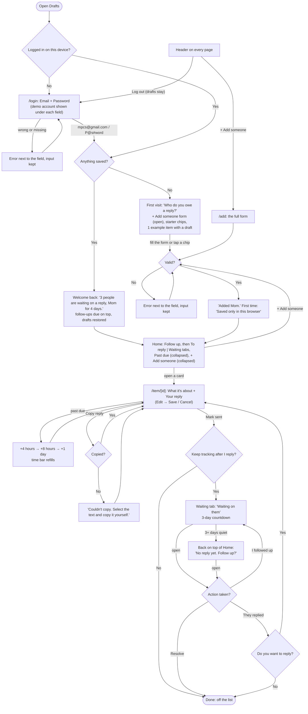

# Drafts

**Replies you owe, in one place.**

You see a message you can't answer yet. Log it in a few seconds, start the reply when you have a minute, copy it into Messages or Gmail, and check it off. When you come back, your half-finished drafts and the people you're waiting on are still there.

Built for Design, Build, Ship (MPCS 51238), Assignment 3: Patterns & Flows.

- **Live:** _add Vercel URL_
- **Demo login:** `mpcs@gmail.com` / `P@s#word` (a mock login; there are no real accounts)
- **Stack:** Next.js (App Router) + Tailwind CSS. Everything is saved in your browser with localStorage. No database, backend, or external APIs.

## Who it's for

Someone who reads messages in the moment but can't always answer them right away: a student juggling texts from family, a group chat, a recruiter's email, and a Slack thread. Today those replies live in your head or as unread badges. Drafts gives them one list, a deadline, and a place to start the reply before you forget what you wanted to say.

## Main task

> I get a message I can't answer yet → I add it to Drafts → I start a reply when I have a minute → I copy it, send it, and check it off → when I come back, my half-finished drafts and who's waiting are still there.

## Flows



Item states, every form error, and the wording rules are in [flows.md](flows.md).

## Pages

| Route | What's on it |
|---|---|
| `/login` | Mock login. Only the demo account gets in; anything else shows "Incorrect email or password." |
| `/` | First visit: prompt, the full add form, starter chips, an example item. Coming back: welcome greeting, follow-ups due, a sliding **To reply \| Waiting** switch, a closed **Past due** panel for replies past their date, and "+ Add someone" below the list |
| `/add` | The same add form on its own page |
| `/item/[id]` | The person, the time bar, What it's about and Your reply (Edit → Save / Cancel), Copy reply, Mark sent, Keep tracking, Boost, and Delete. Waiting items show the conversation and "Action taken?" |

Every page shares a header: the **Drafts** logo (always goes home), **+ Add someone** (opens the full form from anywhere, however long the list gets), and **Log out**.

Two routes aren't linked and are only for testing and walkthroughs:
- `/demo/fresh` clears everything (including the login), so the next visit is a true first visit.
- `/demo` replaces saved data with sample people in every state: past due, due today, drafts in progress, no rush, and conversations waiting on a reply.

## First visit (onboarding)

There's no tour and no empty screen. After logging in, someone new sees:

1. **"Who do you owe a reply?"** with one line on what the tool is for.
2. **The add form, already open.** Who, Where, What's it about?, Your reply, Reply by, and Keep tracking. Only Who and Where are required, and Reply by defaults to This week.
3. **Starter chips** (+ Mom, + Group chat, + Recruiter, + Landlord). One tap adds a real item.
4. **An example card** (Sam, "Are you still coming Saturday?") showing what an item with a draft looks like: the app icon, the preview, the reply-by date, and the time bar.

Their first save shows "Added Mom. Saved only in this browser, so it'll be here next time you open Drafts on this device." That's the first and only time the app talks about storage.

## Coming back

### What it remembers

| What | localStorage key | Effect |
|---|---|---|
| Every person, note, draft, deadline, boost, and conversation | `drafts:v1` | The list survives closing the tab or restarting the browser |
| When you last opened Drafts | `drafts:lastVisit` | Powers the "Welcome back" greeting |
| That you passed the login | `drafts:signedIn` | Log out keeps your drafts; log back in and they're still there |
| That you've seen the storage note | `drafts:savedNoteShown` | "Saved only in this browser" appears once |

Corrupt or missing data starts fresh instead of crashing. If the browser blocks storage, a banner says "This browser isn't saving."

### Why you'd come back

- **A reply you started.** The point of Drafts is to start the reply when you have a minute and finish it later, so a half-written draft is waiting for you.
- **Deadlines that move.** Each card shows "Reply by 10/20 · 2 days left" over a time bar that drains toward the date and turns amber when time is short. To reply is sorted most urgent first.
- **A greeting that tells you what changed:** "Welcome back. 3 people are waiting on a reply, Mom for 4 days."
- **Follow-up nudges.** Turn on "Keep tracking after I reply" and the conversation moves to Waiting. If they go quiet for 3 days, it comes back to the top of Home: "No reply yet. Follow up?"
- **A way back from missing a date.** A past-due card greys out (calm, not alarming) and offers **+4 hours**. Each tap gives more time (4 hours → 8 hours → 1 day), so you can still recover an overdue item.

## The form and its errors

- One column, a real `<label>` on every field, and "(optional)" on the optional ones.
- Errors sit under the field and say what to do next: "Enter who you need to reply to.", "Pick where the message came from.", "Choose a date, or pick one of the options above."
- On submit, focus moves to the first problem, and nothing the person typed is cleared. After the first submit, errors update as you fix them.
- The login follows the same rules: "Enter your email.", "Enter an email like name@example.com.", and "Incorrect email or password. Use the demo login shown under each field."

## Shared components

Everything is built from one set of components in [components/](components/): `Button`, `TextField` / `TextArea`, `Field`, `ChipGroup`, `Checkbox`, `Banner`, `Nav`, `ItemCard`, `Tabs`, `TimeBar`, `ChannelIcon`, `Tag`, and `BoostButton`. Colors, radii, and shadows come from tokens in [app/globals.css](app/globals.css) (a "calm modern" deep-teal theme), and pages use semantic classes like `text-ink-soft` and `bg-accent`, never raw palette colors.

## Accessibility

- **Keyboard:** everything works without a mouse. There's a "Skip to content" link, chip groups are real radio groups (arrow keys move the selection), the To reply | Waiting switch is a tab list, and focus moves somewhere sensible after saving, cancelling, or opening an editor.
- **Labels:** every input has a visible label; hints and errors are tied to their field with `aria-describedby`; confirmations are announced with `role="status"`.
- **Contrast:** every text color pair in the theme was checked against WCAG AA with the agent, and graphics (time bar fills, app icons) are at least 3:1 against white. Overdue cards grey out but stay AA-readable, and state is never shown by color alone ("2 days past", "Draft started").

## Onboarding research

Three subagents studied how similar tools welcome someone new: the first screen, what they ask for, and how soon you get something useful.

| | First screen | Asks for | Time to value | Brings you back by |
|---|---|---|---|---|
| **Gmail nudges** | No onboarding. On by default; old emails jump to the top with "Received 3 days ago. Reply?" | Nothing | Days (needs a quiet thread) | Moving emails to the top of the inbox you already check |
| **Boomerang** | Optional Start/Skip tour, then new buttons inside Gmail | Google sign-in; "Allow" only on first use | Under a minute | Putting unanswered emails back in your inbox ("if no reply") |
| **Apple Reminders** | No welcome screen; opens on Today / Scheduled lists | Nothing | Seconds: "+ New Reminder", type, done | Today list includes overdue items; badge count |

**What Drafts uses:**
- **No tour, no welcome page.** Like all three, the first screen is the tool: the add form, starter chips, and one example item showing a draft.
- **Adding right on Home** (Reminders). It started as a two-field quick-add; after trying it, I switched the first visit to the full form, open in place, so new users see every option (notes, draft, date) without leaving Home.
- **A "Tomorrow" option** in Reply by (Reminders, Boomerang).
- **"Keep tracking after I reply" as one checkbox**, like Boomerang's "if no reply," instead of a separate choice.
- **Follow-ups come back to Home** (Boomerang, Gmail): conversations quiet for 3+ days return to the top with "No reply yet. Follow up?"
- **Ask for nothing up front** (Boomerang): "Saved only in this browser" appears after the first save, not before.

**What Drafts avoids:**
- Unexplained or guilt-heavy nudges (a common complaint about Gmail). Drafts uses calm wording, and overdue cards grey out instead of turning red.
- Counts that can be wrong (Reminders' badge). Counts come from the same list you see.
- Hidden key features (Reminders' "When Messaging" is buried and works only in Apple's Messages app). Who and Where are the first two fields.

## First-run check

_To do after deploying: give the agent the Vercel URL and a goal ("Log in, add three people you owe a reply this week, start a reply to one, then come back later"), have it go through the first visit, the main task, and a return visit, and paste its usability feedback here along with what changed._

| Feedback | What I changed |
|---|---|
| _…_ | _…_ |

## Run it locally

```bash
npm install
npm run dev
```

Then open [http://localhost:3000](http://localhost:3000) and log in with `mpcs@gmail.com` / `P@s#word`. Open [/demo/fresh](http://localhost:3000/demo/fresh) to start over as a brand-new user, or [/demo](http://localhost:3000/demo) to load sample data.
