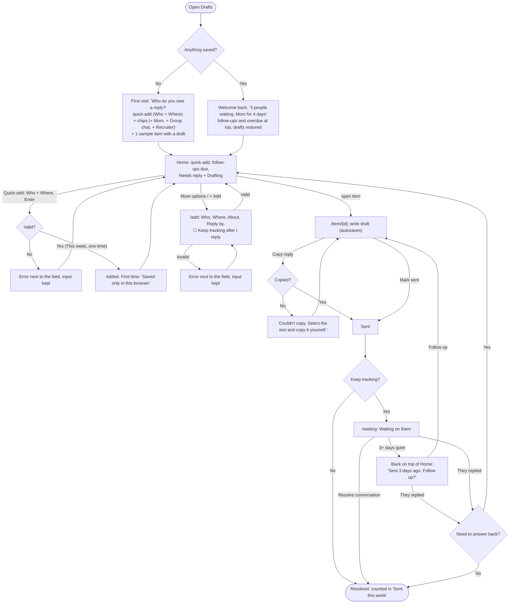

# Drafts

**Replies you owe, in one place.**

You see a message you can't answer yet. Log it in a few seconds, start the reply when you have a minute, copy it into Messages or Gmail, and check it off. When you come back, your half-finished drafts and the people you're waiting on are still there.

Built for Design, Build, Ship (MPCS 51238), Assignment 3: Patterns & Flows.

- **Live:** _coming soon_
- **Stack:** Next.js + Tailwind CSS. Everything is saved in your browser (localStorage). No accounts, database, or APIs.

## Main task

> I get a message I can't answer yet → I add it to Drafts → I start a reply when I have a minute → I copy it, send it, and check it off → when I come back, my half-finished drafts and who's waiting are still there.

## Flows



Item states, pages, and every form error are in [flows.md](flows.md).

## Onboarding research

_To do: how three similar tools welcome someone new, and what Drafts borrows._

## First-run check

_To do: the agent's usability feedback after trying the deployed app as a brand-new user, and what changed._

## Run it locally

```bash
npm install
npm run dev
```

Then open [http://localhost:3000](http://localhost:3000).
