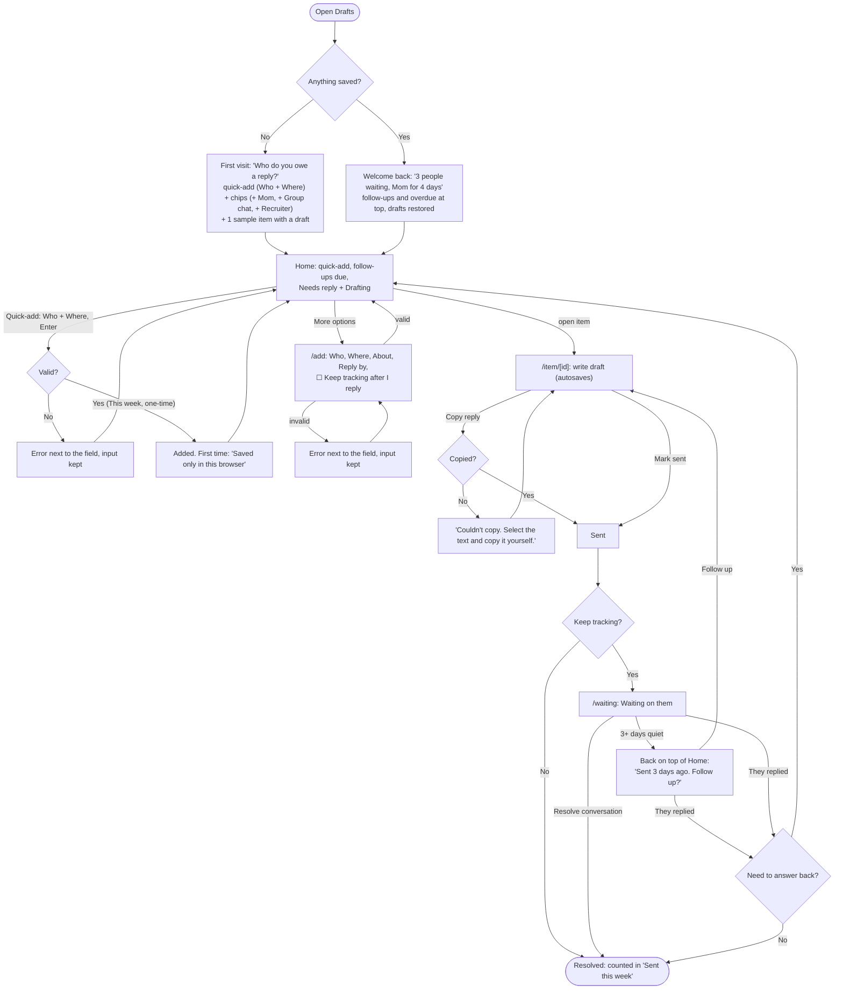

# Drafts

**Replies you owe, in one place.**

You see a message you can't answer yet. Log it in a few seconds, start the reply when you have a minute, copy it into Messages or Gmail, and check it off. When you come back, your half-finished drafts and the people you're waiting on are still there.

Built for Design, Build, Ship (MPCS 51238), Assignment 3: Patterns & Flows.

- **Live:** _coming soon_
- **Stack:** Next.js + Tailwind CSS. Everything is saved in your browser (localStorage). No accounts, database, or APIs.

## Main task

> I get a message I can't answer yet → I add it to Drafts → I start a reply when I have a minute → I copy it, send it, and check it off → when I come back, my half-finished drafts and who's waiting are still there.

## Flows



Item states, pages, and every form error are in [flows.md](flows.md).

## Onboarding research

Three subagents studied how similar tools welcome someone new: the first screen, what they ask for, and how soon you get something useful.

| | First screen | Asks for | Time to value | Brings you back by |
|---|---|---|---|---|
| **Gmail nudges** | No onboarding. On by default; old emails jump to the top with "Received 3 days ago. Reply?" | Nothing | Days (needs a quiet thread) | Moving emails to the top of the inbox you already check |
| **Boomerang** | Optional Start/Skip tour, then new buttons inside Gmail | Google sign-in; "Allow" only on first use | Under a minute | Putting unanswered emails back in your inbox ("if no reply") |
| **Apple Reminders** | No welcome screen; opens on Today / Scheduled lists | Nothing | Seconds: "+ New Reminder", type, done | Today list includes overdue items; badge count |

**What Drafts uses:**
- **No tour, no welcome page.** Like all three, the first screen is the tool: a "Who do you owe a reply?" quick-add, starter chips, and one sample item showing a draft.
- **Quick-add on Home** (Reminders): Who + Where, press Enter. The full form is one click away for more options.
- **A "Tomorrow" option** in Reply by (Reminders, Boomerang).
- **"Keep tracking after I reply" as one checkbox** beside Reply by, like Boomerang's "if no reply," instead of a separate choice.
- **Follow-ups come back to Home** (Boomerang, Gmail): conversations quiet for 3+ days return to the top with "Sent 3 days ago. Follow up?"
- **Gmail's sentence pattern**, plus the reason the item is there: "Received 3 days ago. Reply? You said by Fri."
- **Ask for nothing up front** (Boomerang): "Saved only in this browser" appears after the first save, not before.

**What Drafts avoids:**
- Unexplained or guilt-heavy nudges (a common complaint about Gmail). Drafts uses calm wording and a text label, not alarm colors alone.
- Counts that can be wrong (Reminders' badge). Counts come from the same list you see.
- Hidden key features (Reminders' "When Messaging" is buried and works only in Apple's Messages app). Who and Where are on the main form.

## First-run check

_To do: the agent's usability feedback after trying the deployed app as a brand-new user, and what changed._

## Run it locally

```bash
npm install
npm run dev
```

Then open [http://localhost:3000](http://localhost:3000).
