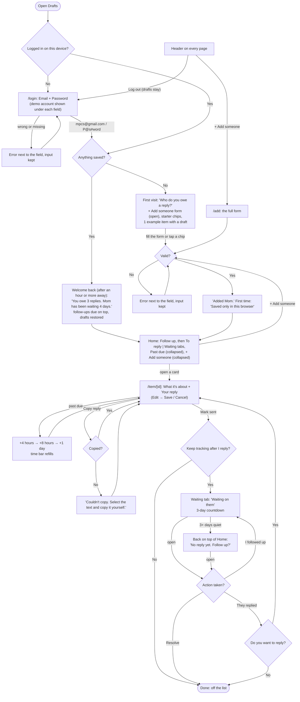
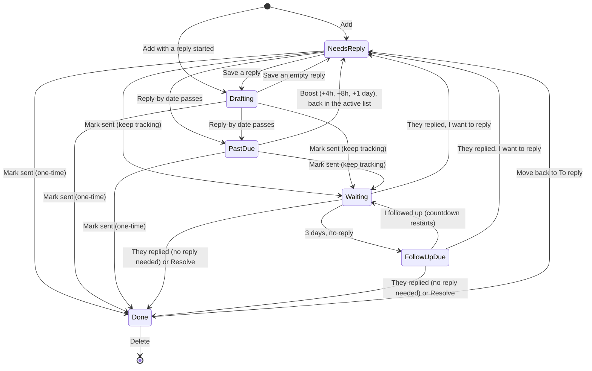

# Drafts: User Flows

## Main task

> I get a message I can't answer yet → I add it to Drafts → I start a reply when I have a minute → I copy it, send it, and check it off → when I come back, my half-finished drafts and who's waiting are still there.

## Full flow

## Item states

Past due isn't a separate saved status. It's a To reply item whose reply-by date has passed, and the same goes for Follow up due, which is a Waiting item quiet for 3+ days. Both are worked out from the dates each time Home loads. "They replied → Yes" brings the item back as received today, due This week, with an empty reply. Boosts are cleared when they reply or the item is reopened.

## Pages

| Route | What's on it |
|---|---|
| `/login` | Mock login: Email and Password, with the demo account (`mpcs@gmail.com` / `P@s#word`) shown under each field. Every other page (except `/demo` tools) sends you here until you've logged in once on this device |
| `/` | **First visit:** "Who do you owe a reply?", the + Add someone form already open, starter chips (+ Mom, + Group chat, + Recruiter, + Landlord), and an example card with a draft. **Coming back:** "Welcome back" greeting, Follow up (quiet 3+ days), the sliding **To reply \| Waiting** switch, a closed **Past due · N** panel at the bottom of To reply, then a closed + Add someone panel |
| `/add` | The full add form on its own page |
| `/item/[id]` | Person, reply-by line and time bar, Boost when past due, Conversation (once there's back-and-forth), What it's about and Your reply (Edit → Save / Cancel; an empty reply is a blank box to click into), Copy reply, Mark sent, Keep tracking after I reply, Delete. Waiting items show "Action taken?" instead of the reply box; done items show "Move back to To reply" |
| `/demo/fresh` | Not linked. Clears everything, including the login, for a true first visit |
| `/demo` | Not linked. Replaces saved data with sample people in every state |

**Shared header on every page:** the **Drafts** logo, which always goes home. While you're logged in it also shows **+ Add someone**, which opens `/add` so adding is one click away however long the list gets, and **Log out**. Logging out clears only the login, so your drafts are still there when you log back in. Both lists live on Home, so there's one place to go back to.

## The forms and their errors

### Add someone (`/` and `/add`)

| Field | Input | Error |
|---|---|---|
| Who (required) | Text | "Enter who you need to reply to." · "Keep the name under 40 characters." |
| Where did it come from? (required) | Text / Email / Slack / DM / Other | "Pick where the message came from." |
| Which email app? (optional, only when Where = Email) | Gmail / Mail (iOS) / Outlook / Yahoo / Other | None. Cards show the app ("Gmail") instead of "Email" |
| What's it about? (optional) | Free text: a quick note ("Dinner Sunday?") or the whole pasted email/text | "Paste just the part you're replying to (under 5,000 characters)." |
| Your reply (optional) | Start the draft now or later | "Shorten your reply to under 5,000 characters." |
| Reply by (required) | Today / Tomorrow / This week / No rush / Pick a date (default: This week) | "Choose a date, or pick one of the options above." · "Pick today or a later date." |
| Keep tracking after I reply | Checkbox (default off = one-time) | None |

Starter chips skip the form: one tap adds the person with Reply by = This week, one-time.

### Login (`/login`)

| Field | Error |
|---|---|
| Email | "Enter your email." · "Enter an email like name@example.com." |
| Password | "Enter a password." · "Incorrect email or password. Use the demo login shown under each field." (for a wrong account) |

### Editing on the item page

What it's about and Your reply are read-only until you click Edit. Then Save keeps the change and Cancel drops it. If the text is too long, the same error as the add form appears and nothing is saved. Waiting actions have their own optional notes ("What did you send?", "What did they say?") with "Paste just the part you need (under 5,000 characters)."

**Every form:** errors sit next to the field and say what to do next, focus moves to the first problem, and nothing the person typed is cleared. After the first submit, errors update as you fix them.

## Wording

- **Card, three levels:**
  1. The name.
  2. A one-line preview of "What's it about?" with the date in small text: "Dinner Sunday? Dad's making… (Received 10/13)". Once replied, the date becomes "Sent 10/16".
  3. "Reply by 10/20 · 2 days left" over the time bar. When it's due today, this shows hours left; with No rush it just says "No rush".
- **Past due:** "Reply by 10/18 · 2 days past". The card and its icon grey out, staying AA-readable, and a **+4 hours** button appears.
- **Waiting:** "Waiting on them", then "No reply yet. Follow up?" after 3 quiet days.
- **Pills:** only "Draft started" and the Boost button.
- **Welcome back** (only after an hour or more away): "You owe 3 replies. Mom has been waiting 4 days." It names the longest-waiting person with a deadline. It adds "1 conversation has gone quiet." when a follow-up is due. With nothing waiting: "You're all caught up."
- **Calm tone:** no alarm colors or guilt wording, and state is never shown by color alone.
- **Counts** ("To reply 3", "Past due 2") are computed from the lists on screen, so they always match.

## Other states and errors

- **Item not found** (`/item/bad-id`): "This draft isn't here anymore. It may have been deleted, or saved in a different browser," with a link to Drafts.
- **Storage blocked:** "This browser isn't saving. Your drafts will disappear when you close the tab." The login still works for that tab.
- **Corrupt saved data:** start fresh with the first-visit screen.
- **Copy fails:** "Couldn't copy. Select the text and copy it yourself." The reply text is selected for you.
- **Copy with no reply:** Copy reply is disabled until a reply is saved.
- **Delete:** asks "Delete Mom and the draft? This can't be undone." with Delete / Keep it.
- **Nothing left to reply to:** "You're all caught up. Add someone below when a message comes in," and + Add someone opens on its own. Never a dead end.
- **Only past-due items left:** "Nothing coming up. The ones past their date are below," with the Past due panel underneath.
- **Waiting is empty:** "No one owes you a reply right now. Turn on 'Keep tracking after I reply' on an item to follow the conversation here."
