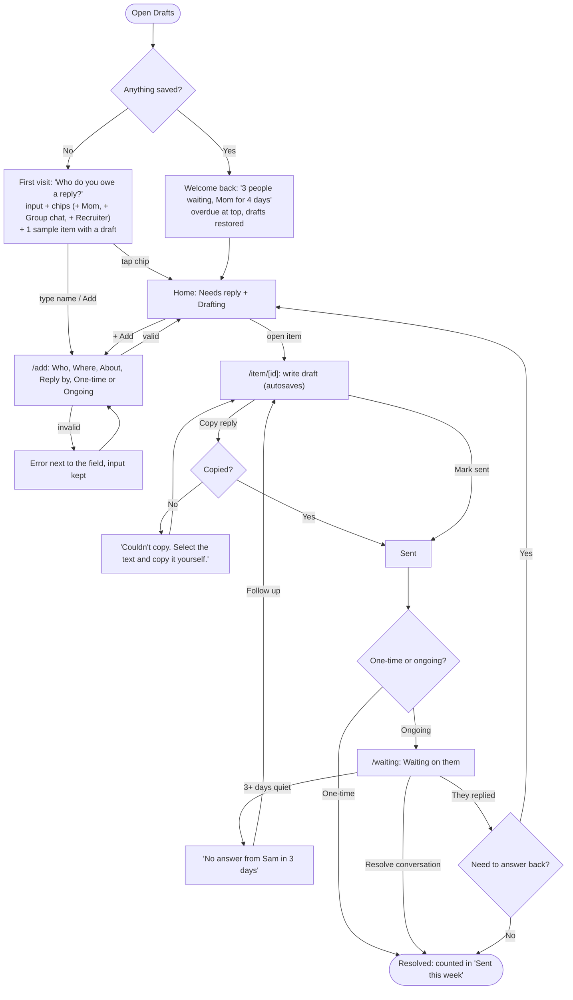
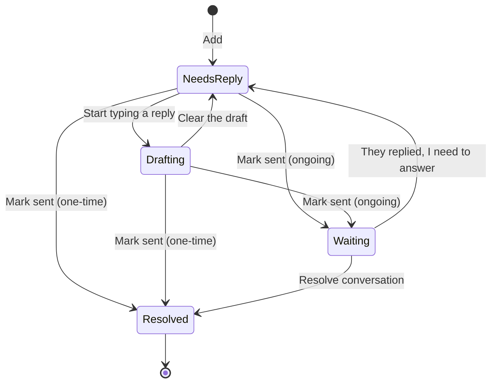

# Drafts: User Flows

## Main task

> I get a message I can't answer yet → I add it to Drafts → I start a reply when I have a minute → I copy it, send it, and check it off → when I come back, my half-finished drafts and who's waiting are still there.

## Full flow

## Item states

## Pages

| Route | What's on it |
|---|---|
| `/` | First visit (prompt, quick-add chips, sample item) or welcome back + Needs reply / Drafting list, overdue first |
| `/add` | The add form |
| `/item/[id]` | Write the draft, Copy reply, Mark sent, switch One-time ↔ Ongoing, Delete |
| `/waiting` | Ongoing conversations waiting on the other person, nudges, "Sent this week" |

Shared nav on every page: **Drafts · Waiting · + Add**, with the current page highlighted.

## The form and its errors

| Field | Input | Error |
|---|---|---|
| Who (required) | Text | "Enter who you need to reply to." · "Keep the name under 40 characters." |
| Where (required) | Text / Email / Slack / DM / Other | "Pick where the message came from." |
| About (optional) | Text | "Keep this under 80 characters." |
| Reply by (required) | Today / This week / No rush / Pick a date | "Choose a date, or pick Today, This week, or No rush." · "Pick today or a later date." |
| Conversation | One-time reply / Ongoing | Always has a value (default: One-time) |

Errors sit next to the field, focus moves to the first problem, and nothing the person typed is cleared.

## Other states and errors

- **Item not found** (`/item/bad-id`): "This draft isn't here anymore," with a link home.
- **Storage blocked:** "This browser isn't saving. Your drafts will disappear when you close the tab."
- **Corrupt saved data:** start fresh with the first-visit screen.
- **Nothing left to reply to:** "You're all caught up," with the add prompt still visible. Never a dead end.
