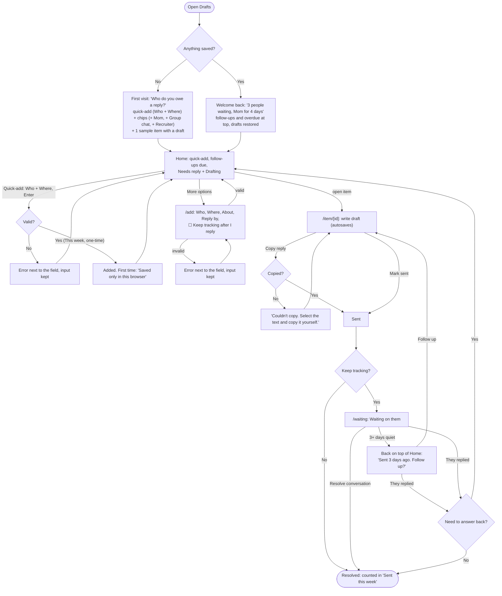
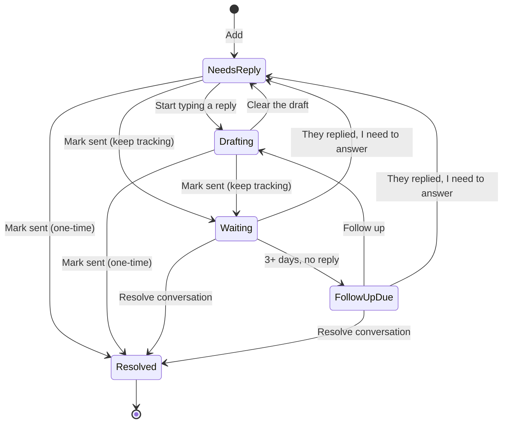

# Drafts: User Flows

## Main task

> I get a message I can't answer yet → I add it to Drafts → I start a reply when I have a minute → I copy it, send it, and check it off → when I come back, my half-finished drafts and who's waiting are still there.

## Full flow

## Item states

## Pages

| Route | What's on it |
|---|---|
| `/` | Quick-add (Who + Where, Enter) on every visit. First visit: prompt, starter chips, sample item. Coming back: welcome greeting, then follow-ups due ("Sent 3 days ago. Follow up?"), overdue, and the Needs reply / Drafting list |
| `/add` | The full add form ("More options") |
| `/item/[id]` | Write the draft, Copy reply, Mark sent, toggle Keep tracking after I reply, Delete |
| `/waiting` | All conversations waiting on the other person (quiet 3+ days ones also surface on Home), "Sent this week" |

Shared nav on every page: **Drafts · Waiting**, with the current page highlighted. Adding happens from Home (quick-add, or "More options" for the full form), so there is one way in, not two.

## The form and its errors

| Field | Input | Error |
|---|---|---|
| Who (required) | Text | "Enter who you need to reply to." · "Keep the name under 40 characters." |
| Where (required) | Text / Email / Slack / DM / Other | "Pick where the message came from." |
| Which email app? (optional, only when Where = Email) | Gmail / Mail (iOS) / Outlook / Yahoo / Other | None. Cards show the app ("Gmail") instead of "Email" |
| About (optional) | Text | "Keep this under 80 characters." |
| Reply by (required) | Today / Tomorrow / This week / No rush / Pick a date (default: This week) | "Choose a date, or pick one of the options above." · "Pick today or a later date." |
| Keep tracking after I reply | Checkbox beside Reply by (default: off = one-time) | None |

Errors sit next to the field, focus moves to the first problem, and nothing the person typed is cleared.

**Quick-add on Home** uses the same Who and Where fields and the same errors, with Reply by = This week and one-time. "More options" opens `/add` with whatever was typed carried over. After the first item ever is saved, a note appears: "Saved only in this browser."

## Wording

- Needs reply: "Received 3 days ago. Reply?" plus why it's here: "You said by Fri."
- Follow-up due: "Sent 3 days ago. Follow up?"
- Overdue uses one accent color **and** a text label ("Past your date"), never alarm wording.
- Counts ("3 people waiting") are computed from the list on screen, so they always match.

## Other states and errors

- **Item not found** (`/item/bad-id`): "This draft isn't here anymore," with a link home.
- **Storage blocked:** "This browser isn't saving. Your drafts will disappear when you close the tab."
- **Corrupt saved data:** start fresh with the first-visit screen.
- **Nothing left to reply to:** "You're all caught up," with the add prompt still visible. Never a dead end.
